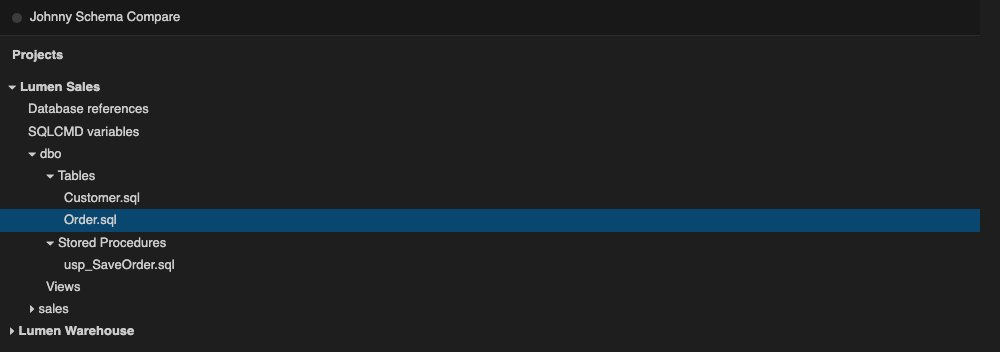
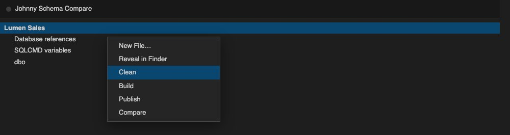
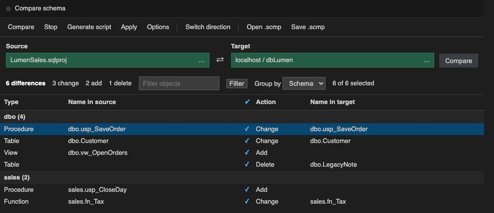
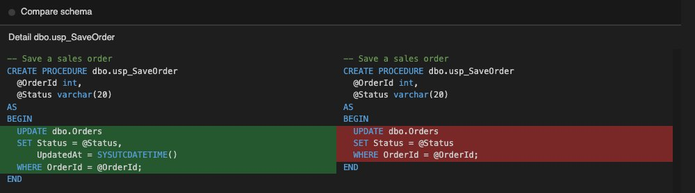
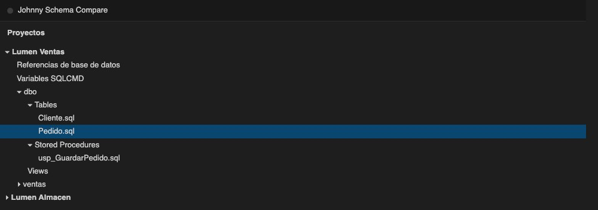
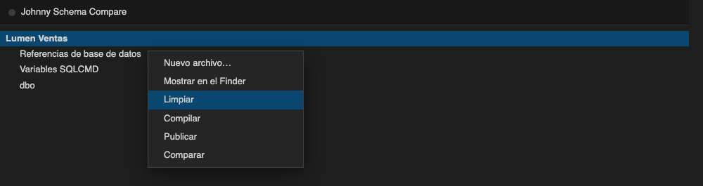
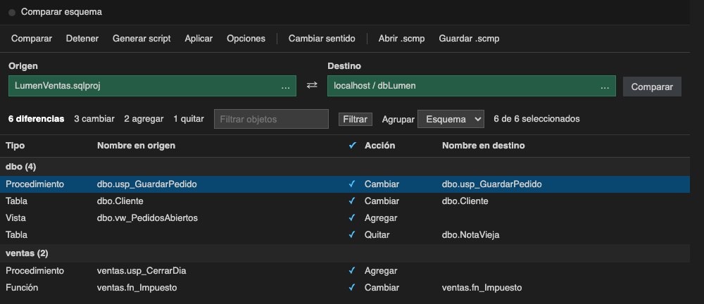
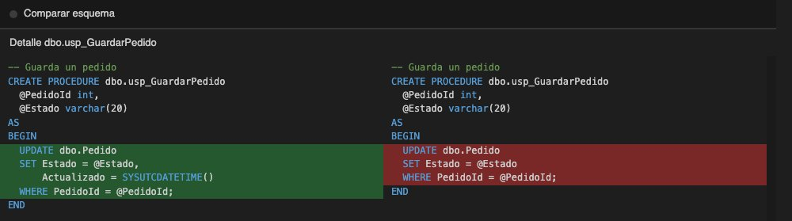

# Johnny Schema Compare

## ☕ Support the project / Apoya el proyecto

Johnny Schema Compare is an independent side project. If it helped you, a **$1 USD** coffee goes a long way — and, honestly, it also helps with a few personal goals (like my mortgage 😁).

👉 [Buy me a coffee (PayPal)](https://paypal.me/SIPTecMX)

⭐ A review on the Marketplace or a star on GitHub also makes a big difference.

---

Extension for **Visual Studio Code** and **Cursor** that compares a classic SQL project (`.sqlproj`) with a local SQL Server database, object by object, and applies only what you select.

**0.0.3** adds user-defined table types (`CREATE TYPE … AS TABLE`).

**Author:** [Johnny Sánchez](https://www.johnnycsh.com) · [CreateIT](https://www.createit.com.mx) · [JohnnyC-SH](https://github.com/JohnnyC-SH)  
Repository: [github.com/JohnnyC-SH/SchemaCompare](https://github.com/JohnnyC-SH/SchemaCompare)

UI strings follow your editor language: **English** by default, **Spanish** when the display language is `es`.

---

## English

### Screenshots

Paths are **relative to the package** so they load on the Marketplace page and when installing from a VSIX.









### Requirements

- Cursor or Visual Studio Code.
- A local SQL Server when the target is the database. Apply and Publish only reach `localhost`.
- Node.js only if you **package** the extension from source.

### What it does

Compare a `.sqlproj` with a local database, in either direction.

| Action | What it does |
|---|---|
| Compare | Lists tables, table types, procedures, views, functions, and triggers that differ. |
| Apply | Writes only the checked objects. |
| Build | Compiles the classic project with DacFx and writes `bin/Debug/<AssemblyName>.dacpac`. Errors open in Problems. |
| Publish | Sends the whole compiled project to a local database you pick. |
| Clean | Removes `bin` and `obj` of the project you right-clicked. |

Right-click the project root: **Clean**, **Build**, **Publish**, **Compare**.

Publish leaves out users, permissions, and role membership. Objects that exist only in the database are not dropped. Publishing stops if a change would delete data.

Each difference has its own checkbox. Select all, then clear any row; that row stays cleared. The same exclusions are on by default in a comparison, and you can turn them back on for that comparison. Schema only: this extension does not compare data.

### Development

```bash
git clone https://github.com/JohnnyC-SH/SchemaCompare.git
cd SchemaCompare
npx @vscode/vsce package
```

Install in Cursor or VS Code:

```bash
cursor --install-extension johnny-schema-compare-0.0.3.vsix
# or: code --install-extension …
```

*(Adjust the `.vsix` filename to the current `package.json` version.)*

### Contributing

- **Issues:** [bugs and ideas](https://github.com/JohnnyC-SH/SchemaCompare/issues).
- **Pull requests:** fork the repo, branch your change, and open a PR against `main`.

### More projects by Johnny Sánchez

| Project | What it is |
|---|---|
| [johnnycsh.com](https://www.johnnycsh.com) | Author site — projects, services, contact |
| [.NET Convenience](https://github.com/JohnnyC-SH/DotNet_convenience) | Shortcuts for common .NET workflows in VS Code and Cursor |
| [JohnnyMsgBox](https://github.com/JohnnyC-SH/JohnnyMsgBox) | MessageBox / dialogs / toasts for Blazor & HTML |
| [JohnnyIconMaker](https://github.com/JohnnyC-SH/JohnnyIconMaker) | App icon packing (Windows, macOS, mobile) |
| [create.it](https://www.createit.com.mx) | CreateIT website & brand |

### License

MIT — see `LICENSE` in this folder.

---

## Español

Extensión para **Visual Studio Code** y **Cursor** que compara un proyecto SQL clásico (`.sqlproj`) con una base local de SQL Server, objeto por objeto, y aplica solo lo que marques.

**0.0.3** agrega los tipos de tabla (`CREATE TYPE … AS TABLE`).

**Autor:** [Johnny Sánchez](https://www.johnnycsh.com) · [CreateIT](https://www.createit.com.mx) · [JohnnyC-SH](https://github.com/JohnnyC-SH)  
Repositorio: [github.com/JohnnyC-SH/SchemaCompare](https://github.com/JohnnyC-SH/SchemaCompare)

*(En instalaciones por `.vsix`, Cursor/VS Code a veces **no muestra** el botón “Sponsor” del `package.json`; el enlace de PayPal del inicio es el que siempre funciona.)*

Los textos de la interfaz respetan el idioma del editor: **inglés** por defecto y **español** con idioma de visualización `es`.

### Capturas

Las rutas son **relativas al paquete** para que carguen en la ficha de Marketplace y al instalar desde VSIX.









### Requisitos

- Cursor o Visual Studio Code.
- SQL Server local cuando el destino es la base. Aplicar y Publicar solo llegan a `localhost`.
- Node.js solo si vas a **empaquetar** la extensión desde el código fuente.

### Qué hace

Compara un `.sqlproj` con una base local, en los dos sentidos.

| Acción | Qué hace |
|---|---|
| Comparar | Lista tablas, tipos de tabla, procedimientos, vistas, funciones y desencadenadores que difieren. |
| Aplicar | Escribe solo los objetos marcados. |
| Compilar | Arma el proyecto clásico con DacFx y escribe `bin/Debug/<AssemblyName>.dacpac`. Los errores se abren en Problemas. |
| Publicar | Manda el proyecto compilado completo a una base local que eliges. |
| Limpiar | Quita `bin` y `obj` del proyecto al que le abriste el menú. |

Clic derecho en la raíz del proyecto: **Limpiar**, **Compilar**, **Publicar**, **Comparar**.

Publicar deja fuera usuarios, permisos y pertenencia a roles. Lo que solo existe en la base no se borra. La publicación se detiene si un cambio borraría datos.

Cada diferencia tiene su checkbox. Se puede marcar todo y luego quitar una fila; esa fila se queda sin marca. Esas mismas exclusiones vienen activadas en la comparación, y puedes volver a incluirlas en esa comparación. Solo esquema: esta extensión no compara datos.

### Desarrollo

```bash
git clone https://github.com/JohnnyC-SH/SchemaCompare.git
cd SchemaCompare
npx @vscode/vsce package
```

Instalar en Cursor o VS Code:

```bash
cursor --install-extension johnny-schema-compare-0.0.3.vsix
# o: code --install-extension …
```

*(Ajusta el nombre del archivo `.vsix` a la versión actual del `package.json`.)*

### Colaboración

- **Issues:** [problemas y ideas](https://github.com/JohnnyC-SH/SchemaCompare/issues).
- **Pull requests:** bifurca el repo, crea una rama con tu cambio y abre un PR contra `main`.

### Más proyectos de Johnny Sánchez

| Proyecto | Qué es |
|---|---|
| [johnnycsh.com](https://www.johnnycsh.com) | Sitio del autor — proyectos, servicios, contacto |
| [.NET Convenience](https://github.com/JohnnyC-SH/DotNet_convenience) | Atajos para flujos habituales de .NET en VS Code y Cursor |
| [JohnnyMsgBox](https://github.com/JohnnyC-SH/JohnnyMsgBox) | MessageBox / diálogos / toasts para Blazor y HTML |
| [JohnnyIconMaker](https://github.com/JohnnyC-SH/JohnnyIconMaker) | Generación / empaquetado de iconos (Win, Mac, móvil) |
| [create.it](https://www.createit.com.mx) | Sitio y marca CreateIT |

### Licencia

MIT — ver `LICENSE` en esta carpeta.
